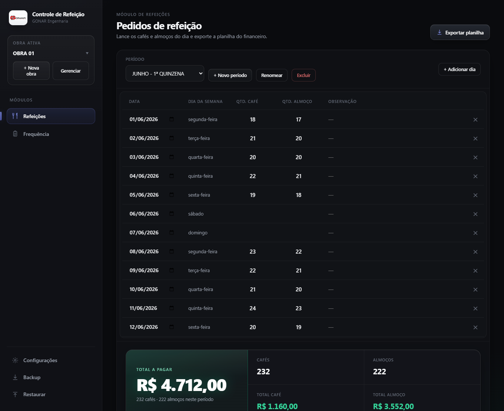
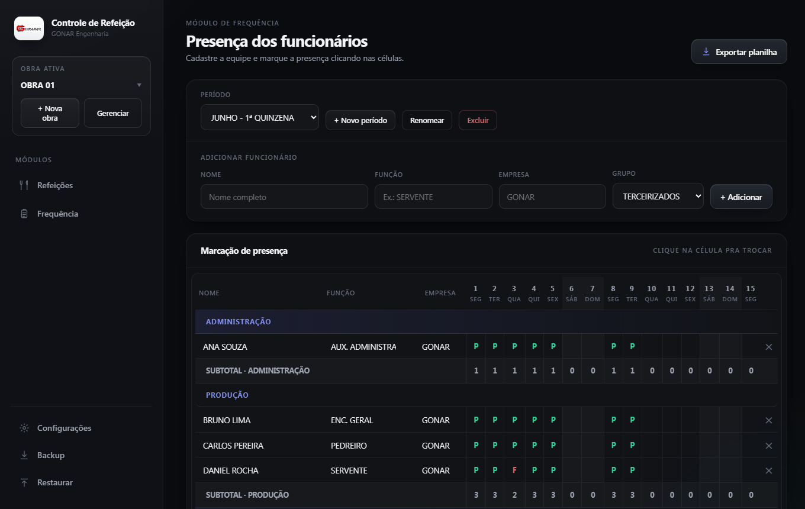
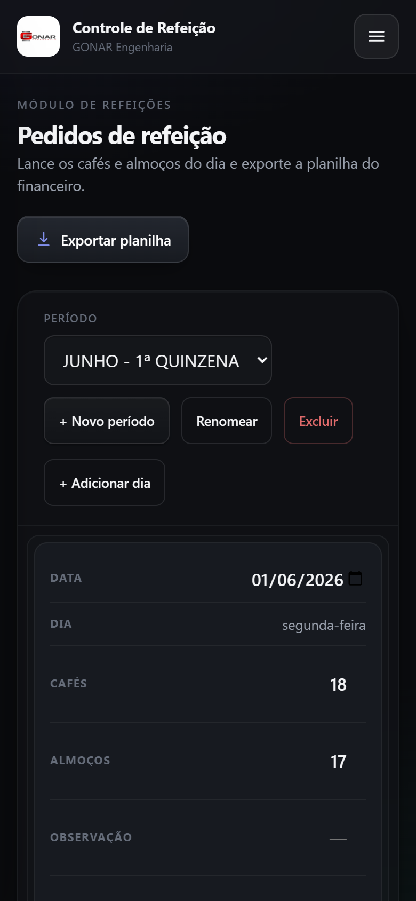
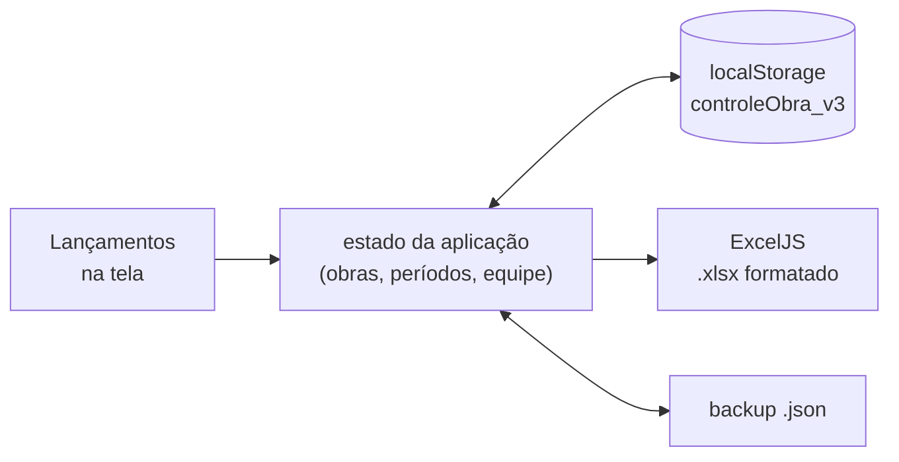

<p align="center">
  <picture>
    <source media="(max-width: 767px)" srcset="https://raw.githubusercontent.com/IsaacGomes260653/Controle-de-Refeicao/main/.github/banner-mobile.svg">
    
  </picture>
</p>

<p align="center">
  <b>Troca as planilhas de refeição e de presença de uma obra por um único arquivo HTML que funciona sem internet e gera o Excel pronto para o financeiro.</b>
</p>

<p align="center">
  
  
  
  
  <a href="LICENSE"></a>
  
</p>

Criei o RanchoControl em 2026, quando trabalhava na **GONAR Engenharia Civil**, para substituir as planilhas de controle de refeições e de presença das obras. Eu não uso mais o sistema. Hoje ele faz parte do meu portfólio.

## Capturas



<table>
  <tr>
    <td width="68%" valign="top"></td>
    <td width="32%" valign="top"></td>
  </tr>
</table>

Capturas feitas com o Playwright, abrindo o `index.html` no navegador. A obra, os números e os nomes da equipe são fictícios.

## Funcionalidades

- **Várias obras**, cada uma com os próprios períodos, preços do café e do almoço, empresa padrão e assinatura.
- **Refeições**
  - Período criado a partir da data inicial e do número de dias (uma quinzena ou o mês inteiro), com o dia da semana preenchido sozinho.
  - Lançamento rápido como numa planilha: `Enter` ou `↓` desce uma linha, `↑` sobe, célula vazia vale 0, e um ponto de arrastar copia o valor para cima ou para baixo.
  - Totais na hora: cafés, almoços, valor de cada um e o total a pagar.
  - Exportação para `.xlsx` com a logo no topo, bordas, dia da semana por extenso e os totais em reais.
- **Frequência**
  - Equipe dividida em administração, produção e terceirizados, com sugestão de funções comuns de obra.
  - Presença marcada clicando na célula, que alterna entre `P` (presente), `F` (falta), `A` (atestado), `NP` (não presente), `FE` (férias) e `DE` (demitido). Sábados e domingos aparecem destacados.
  - Subtotais por grupo e da obra, resumo por função e assinatura no rodapé, também exportados para `.xlsx`.
- **Backup e restauração** de todos os dados num arquivo `.json`, para levar para outro computador.
- **Funciona no celular**: a tabela de refeições vira cartões, e a coluna de nomes fica fixa na frequência.

## Tecnologias

| Tecnologia | Por quê |
|---|---|
| HTML, CSS e JavaScript puros, num arquivo só | Quem usava não precisava instalar nada: bastava copiar o arquivo e dar dois cliques, até num computador sem internet. |
| [ExcelJS](https://github.com/exceljs/exceljs), embutido no HTML | Gera o `.xlsx` com células mescladas, bordas, cores e a logo, no formato que o financeiro já recebia. Embutido para funcionar offline. |
| localStorage | Guarda os lançamentos no próprio navegador, sem servidor e sem conta. |
| JSON (backup) | O localStorage fica preso a um navegador. O backup leva os dados para outro computador e protege contra limpeza do navegador. |

## Como funciona



- O `index.html` tem três partes: o estilo, a biblioteca ExcelJS (cerca de 950 KB) e o código da aplicação (cerca de 70 KB, com a logo em base64).
- Todo o estado (obras, períodos, lançamentos, equipe e configurações) é um único objeto, salvo no `localStorage` a cada mudança. Se o navegador não deixar salvar, o sistema continua funcionando só na memória, e o backup passa a ser o jeito de guardar os dados.
- Os dados ficam na chave `controleObra_v3`. Quem tinha a versão anterior (`controleObra_v2`, com uma obra só) tem os dados migrados automaticamente na primeira abertura.
- Na exportação, o ExcelJS monta a planilha célula a célula e o navegador baixa o arquivo, com nomes como `REFEICOES_<obra>_<período>.xlsx`.

## Como rodar

**Pré-requisitos:** só um navegador (Chrome, Edge ou Firefox). Não precisa de internet, servidor nem instalação.

1. Baixe o projeto: `git clone https://github.com/IsaacGomes260653/Controle-de-Refeicao.git` ou, no GitHub, **Code → Download ZIP**.
2. Dê dois cliques no `index.html`. Ele abre no navegador já com uma obra de exemplo.
3. Em **Refeições**, clique em **+ Novo período**, escolha a data inicial e o número de dias e lance os cafés e almoços. Em **Exportar planilha**, o `.xlsx` é baixado.

Não há demonstração publicada: era um sistema interno da obra.

> Os dados ficam no navegador daquele computador. Limpar os dados do navegador apaga os lançamentos, então use **Backup** com frequência.

## Estrutura de pastas

```
.
├── index.html     # o sistema inteiro: estilo, ExcelJS e o código da aplicação
├── LICENSE
├── README.md
└── .github/       # banner, capturas e imagem de compartilhamento
```

## O que eu aprendi

- Ferramenta interna tem que se parecer com o que as pessoas já usam: quem lançava estava acostumado ao Excel, então o `Enter`, as setas e o arrastar para preencher pesaram mais do que qualquer tela bonita.
- Guardar dados só no navegador funciona, mas cobra o preço depois: precisei de backup em arquivo e de uma migração quando o formato mudou da versão 2 para a 3.
- Uma planilha "bonita" é feita de muitos detalhes (mesclar células, bordas, larguras, imagem), e o ExcelJS deixa controlar todos eles pelo código.
- A versão para celular veio depois, com cartões no lugar da tabela, a coluna de nomes fixa e campos que não dão zoom no iPhone.

## Próximos passos

O projeto não está em desenvolvimento. Se eu voltar a ele:

- [ ] Deixar o nome da empresa no cabeçalho configurável (hoje é sempre "GONAR Engenharia").
- [ ] Testes automáticos para os totais e para as planilhas exportadas.
- [ ] Sincronizar os dados entre computadores, o que exigiria um servidor.

## Créditos

- Criado para as obras da GONAR Engenharia Civil. A logo embutida é da GONAR.
- Planilhas geradas com o [ExcelJS](https://github.com/exceljs/exceljs) (licença MIT), embutido no `index.html`.

## Licença

O código está sob a licença [MIT](LICENSE).

## Contato

Isaac Gomes de Moraes · [LinkedIn](https://www.linkedin.com/in/isaacgomesmoraes/) · [e-mail](mailto:isaacgm260653@gmail.com) · [GitHub](https://github.com/IsaacGomes260653)
